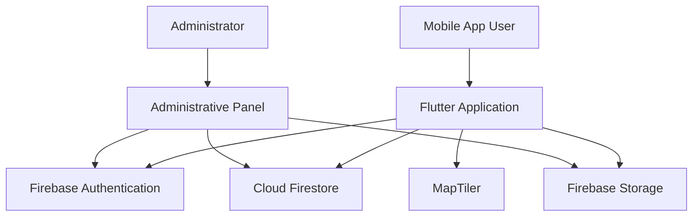

# Conceptual System Architecture

The diagram below is a high-level explanation for portfolio purposes. It is not a reverse-engineered diagram of the original source code.

## Component responsibilities

| Component | Responsibility |
|---|---|
| Flutter application | Mobile user interface and user interactions |
| Firebase Authentication | Account registration and sign-in |
| Cloud Firestore | Application data |
| Firebase Storage | Image/file storage |
| MapTiler | Map visualization |
| Administrative panel | Authorized review and management workflows |

## Security consideration

A role value displayed in the mobile application is not sufficient to secure administrative actions. Access must be enforced with Firebase Security Rules and, where applicable, trusted server-side authorization such as custom claims. Never place administrator credentials in a public repository.
